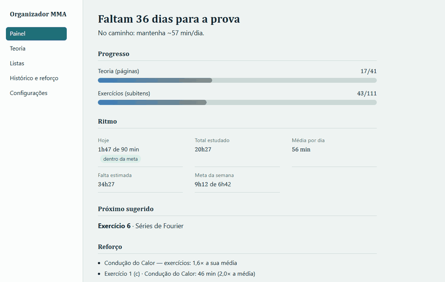
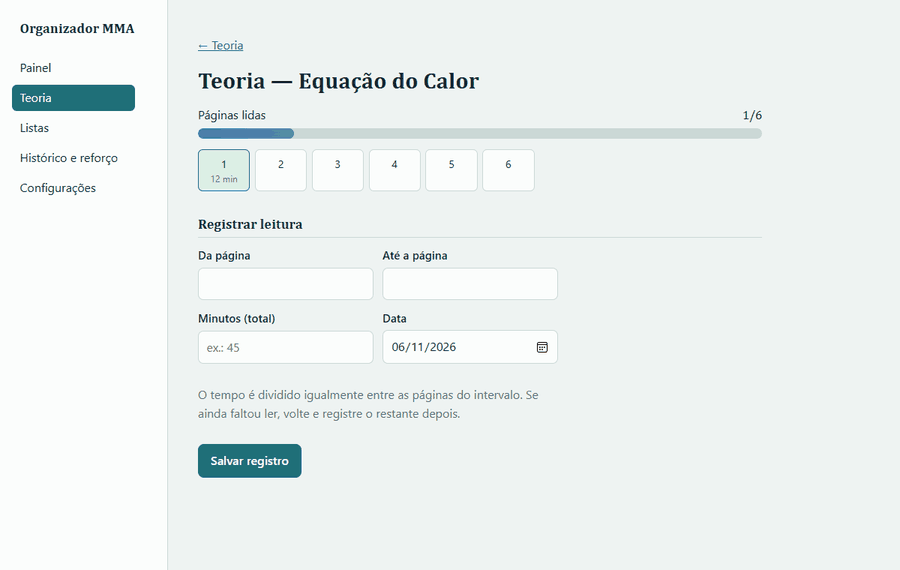
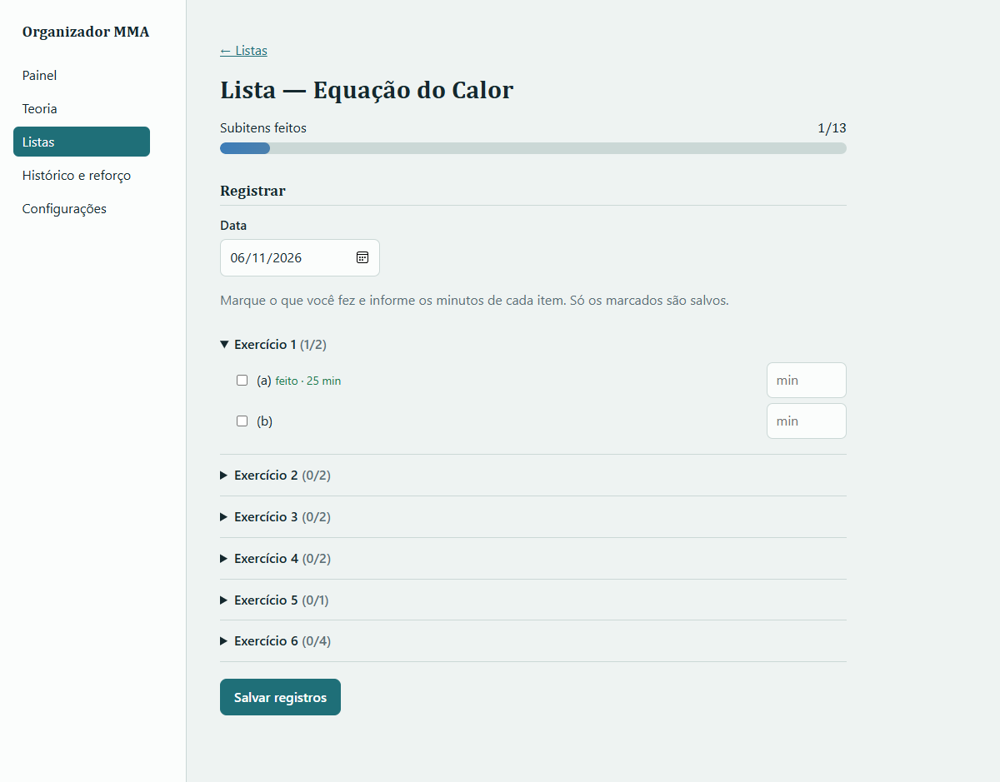

# Study Organizer (MMA)

**English** · [Português](README.pt-BR.md)

A personal app for studying *Applied Mathematics Methods* (MMA) before the exam on Dec 12, 2026. It records **how long each item took**, whether a page of theory or one part of an exercise. From those times it shows progress, study pace, how much work is left and where the hard topics are.

It runs only on your own computer (`localhost`), with no cost. A Telegram bot sends a daily reminder to study.

**▶ [Live demo](https://lucasalan03.github.io/Organizador-de-estudos/)**: a read-only showcase with sample data (the interface is in Portuguese). You can browse every page, but nothing is saved.



| Logging theory pages | Exercise list |
|---|---|
|  |  |

## Features

- **Dashboard:** days until the exam, progress in theory and in exercises, daily average, today's goal (met or not), estimate of the remaining work, weekly goal, a pace verdict, items to review and the next suggested item.
- **Theory:** one progress bar per PDF. You log "pages X to Y" and the time spent.
- **Exercise lists:** one progress bar per list. You check off exercises or their parts and enter the time for each one.
- **History and review:** items and topics that took more than 1.5× your average, minutes per day, and editing or deleting entries.
- **Settings:** daily goal, start and exam dates, reminder time and snooze.
- **Telegram bot:** a daily reminder with the buttons **Consigo agora** (I can now), **Daqui 30 min** (in 30 min) and **Hoje não** (not today).

## How the pace is calculated

- **Daily average** = total minutes ÷ days since the start. It is cumulative and updates every day.
- **The estimate for each unit uses only your own times:** the topic average once 3 or more items are done, otherwise the overall average, otherwise "not enough data".
- **Needed per day** = remaining hours ÷ days until Dec 11. It is compared with your average, and the verdict is *ahead*, *keep going* or *speed up*.
- **The weekly goal** is recalculated every Monday from your entries.

## Install and run

```bash
python -m venv .venv
.venv\Scripts\pip install -r requirements.txt   # Windows
.venv\Scripts\python -m app                      # or double-click iniciar.bat
```

Open <http://127.0.0.1:8765>. Data is stored in `data/study.db`, with a daily backup in `data/backups/` kept for 14 days.

## Telegram bot (daily reminder)

1. Create a bot with @BotFather. Copy `.env.example` to `.env` and fill in `TELEGRAM_BOT_TOKEN`. The `.env` file is never committed.
2. Start the site (`iniciar.bat`). If the token is set, the bot starts with it.
3. In Telegram, send `/start` to the bot. The first `/start` registers your chat, and after that the bot answers only that chat.
4. At 18:30, or at the time set in Settings, the reminder arrives with the three buttons.

Rules:
- No reminder if the day is already marked *studied* or *skipped*, and none after 22:00.
- If the PC was off at 18:30, the reminder is sent once when it starts (until 22:00).
- It uses `httpx` directly against the Telegram Bot API, with no extra library, no cost and no AI.

## Tests

```bash
.venv\Scripts\python -m pytest
```

144 unit and integration tests.

## Project layout

```
app/            code (db, catalog, logs, pace, stats, web, backup, alerts, bot, telegram_api)
app/templates/  Jinja2 pages
app/static/     styles
catalog/        catalog.json: topics, theory pages, exercises and their parts
tests/          unit and integration tests
docs/           design spec and implementation plans
```

`pace.py` holds all the calculations as pure functions with no I/O. `stats.py` reads the database and builds the data for each page.

`scripts/demo_data.py` creates a database with about 3 weeks of sample study. `scripts/build_demo_site.py` turns the site into static pages for the live demo.

**Stack:** Python, FastAPI, Jinja2, SQLite, httpx, pytest.

## Roadmap

- Cloud hosting, to log study sessions from a phone.
